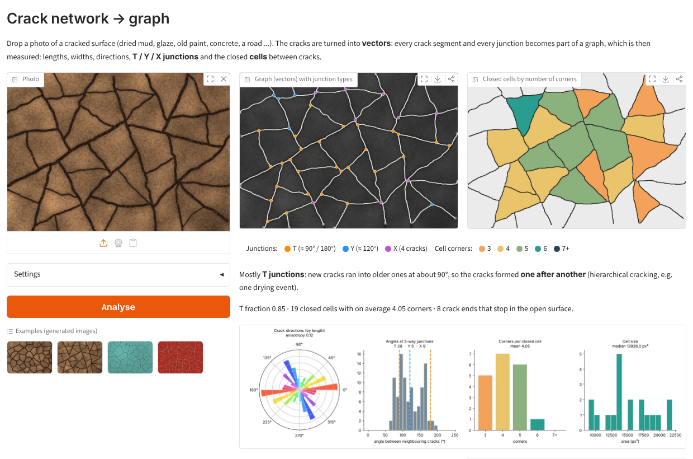
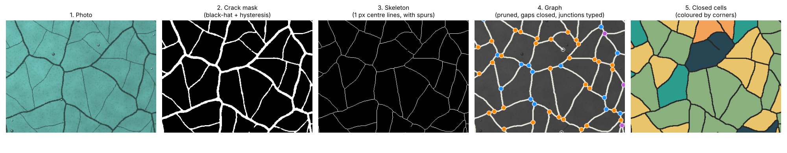
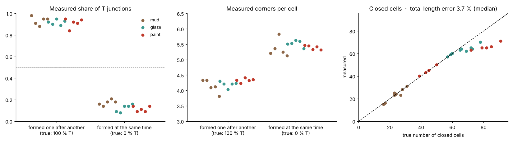
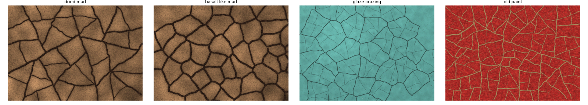

# Crack Network Graph

**Turn a photo of a cracked surface into a graph, and measure it.**
Every crack segment becomes an edge and every junction becomes a node. You get lengths, widths and directions, the **type of every junction (T, Y or X)** and the **closed cells** between the cracks. The junction types show *how* the network formed.

** Live demo:** drop an image and get the results in a few seconds. *(Hugging Face Space: link after deployment, see below.)*



**Skills shown:** classical image processing (morphological black-hat / top-hat, hysteresis thresholding) · skeletonisation and **pixel-to-vector conversion** · graph construction and analysis (NetworkX) · geometric measurements (junction angles, cell topology, orientation statistics) · validation against generated images with a known network · web app (Gradio, Hugging Face Spaces) · vector export (GeoJSON, GraphML)

---

## Why a graph?

Pixel-based crack analysis gives numbers like "8 % of the area is cracked". A graph describes the **structure** of the network:

* **How many cracks, and how long?** Each segment between two junctions is measured on its own: length, width, direction and how wavy it is.
* **How did the network form?** When cracks appear **one after another**, each new crack runs into an older one at about 90°, which makes **T junctions** (Bohn, Pauchard & Couder 2005). Cracks that form **at the same time**, or a network that matures over repeated drying and wetting, meet at about 120° in **Y junctions** (Goehring 2012).
* **What do the pieces look like?** Closed cells and their number of corners: about 4 for T-type networks and about 5–6 for Y-type networks.
* **Can it be reused?** The network is exported as **vectors** (GeoJSON / GraphML). It can be opened in GIS software or loaded with NetworkX, without depending on the image resolution.

## How it works



| Step | Method |
|---|---|
| 1. Grey image | colour → one channel along the colour direction with the most variation (first principal component). Cracks often differ in colour more than in brightness, like pale wood showing through red paint |
| 2. Crack mask | **black-hat** (dark cracks) or **top-hat** (light cracks) keeps structures narrower than the widest crack. The polarity is detected automatically: the correct one has the heavier tail of strong responses. Then **hysteresis thresholding** (Otsu level starts a crack, 65 % of it continues one), and round spots such as bubbles and pebbles are removed |
| 3. Skeleton | 1-pixel centre lines |
| 4. Graph | pixels with 3+ neighbours become **junction nodes** (touching ones are merged), pixels with 1 neighbour become **crack ends**, and the traced paths between them become **edges**. Then: **spur pruning** (dead-end branches shorter than the crack width + 12 px), **gap bridging** (a crack end is extended along its direction and joined to a crack up to 15 px ahead), and **junction merging** (two junctions closer than the crack width become one) |
| 5. Junction type | branch directions measured a little away from the node. **T** if one angle is ≥ 150° (a straight crack with a side branch), otherwise **Y**. **X** for 4+ branches |
| 6. Cells | regions fully enclosed by the network. Each angle at a junction is assigned to the cell that fills it, and it counts as a **corner** unless the boundary runs straight through (≥ 155°) |
| 7. Statistics | total length, density, widths (distance transform), orientation rose and anisotropy, junction-angle histogram, cell sizes and corners |

## Validation

Real photos come without a "true" graph, so [`synth.py`](synth.py) generates crack networks whose structure is known. It covers 3 surfaces (dried mud, crazed glaze, and old paint on wood with *light* cracks), each formed in one of 2 ways:

* **sequential:** each new crack splits the largest piece and ends on older cracks, giving T junctions.
* **simultaneous:** a relaxed Voronoi pattern, giving Y junctions.

All networks are bent with a smooth random warp. [`validate.py`](validate.py) analyses **30 unseen images** (5 seeds per combination) with the **default settings**:

| | All 30 images | T-type networks | Y-type networks |
|---|---|---|---|
| Junctions found (recall / precision, 10 px) | 0.92 / 0.97 | 0.91 / 0.94 | 0.94 / 0.99 |
| Junction type correct (T vs Y) | **90 %** | 92 % | 88 % |
| Measured share of T junctions | | **0.92** (true 1.00) | **0.14** (true 0.00) |
| Mean corners per closed cell | | **4.2** | **5.4** |
| Closed cells: median count error | 4.5 % | 10 % | 0 % |
| Total crack length: median error | 3.7 % (too short) | 4.9 % | 3.4 % |
| Crack polarity (dark / light) detected | 30 / 30 | | |



**The way the network formed is recognised in every image.** The share of T junctions is 0.84–0.98 for networks formed one after another and 0.08–0.21 for networks formed at the same time.

**Limitations:**

- The total length is a few percent **too short**: the skeleton is shortened where cracks meet, and the faintest hairline cracks (old paint) are partly missed. That is also why T-type networks lose some closed cells.
- When two T junctions on both sides of a crack are closer than the crack width, they are merged into **one X**.
- The examples are generated images. On real photos, the settings (widest crack, sensitivity) may need adjusting with the sliders.

## Usage

```bash
pip install -r requirements.txt

python app.py                                      # live demo in the browser (http://127.0.0.1:7860)
python analyze.py examples/*.png --out results     # batch: images, GeoJSON, CSV, GraphML, summary.csv
python analyze.py photo.jpg --px-per-mm 12         # results in mm instead of pixels
python synth.py                                    # regenerate the example images
python validate.py                                 # ~3 min
```

The examples in [`examples/`](examples) are generated by `synth.py`. Each comes with a `.truth.json` file that describes its true network.



### Put the live demo online (free, Hugging Face Spaces)

1. Create a free account at huggingface.co and click **New Space**. Pick a name (e.g. `crack-network-graph`), set **SDK: Gradio** and **Hardware: CPU basic (free)**.
2. Upload `app.py`, `network.py`, `viz.py`, `requirements.txt` and the `examples/` folder (*Files → Add file → Upload files*).
3. The Space builds itself in a few minutes. Then put its link at the top of this README.

## Project structure

```
crack-network-graph/
├── network.py      # segmentation, skeleton -> graph, pruning, gap bridging, junctions, cells, summary
├── viz.py          # graph overlay, cell map, charts, GeoJSON / CSV / GraphML export
├── app.py          # Gradio live demo (Hugging Face Spaces ready)
├── analyze.py      # command line, batch processing
├── synth.py        # crack networks with known structure (mud, glaze, paint; T- or Y-type)
├── validate.py     # accuracy against the known networks
├── make_figures.py # README figures
├── examples/       # generated example images + truth
├── images/         # README figures
└── results/validation.json
```

## Background

This project builds on the methods of my master's thesis on the **vectorisation of crack networks** (pixel → graph). The code here is a new, independent implementation. All images are generated, and no thesis data is used.

## References

* S. Bohn, L. Pauchard, Y. Couder (2005). *Hierarchical crack pattern as formed by successive domain divisions.* Physical Review E 71, 046214.
* L. Goehring (2012). *Evolving fracture patterns: columnar joints, mud cracks and polygonal terrain.* [arXiv:1211.6762](https://arxiv.org/abs/1211.6762).
* O. Sidorov, J. Y. Hardeberg (2019). *"The cracks that wanted to be a graph": application of image processing and graph neural networks to the description of craquelure patterns.* ICCV Workshops, [arXiv:1905.05010](https://arxiv.org/abs/1905.05010).

## License

[MIT](LICENSE)
